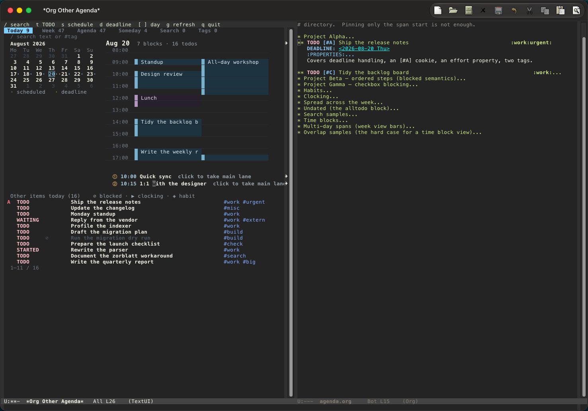
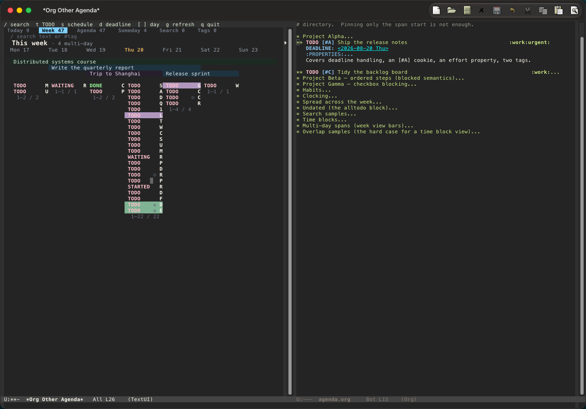
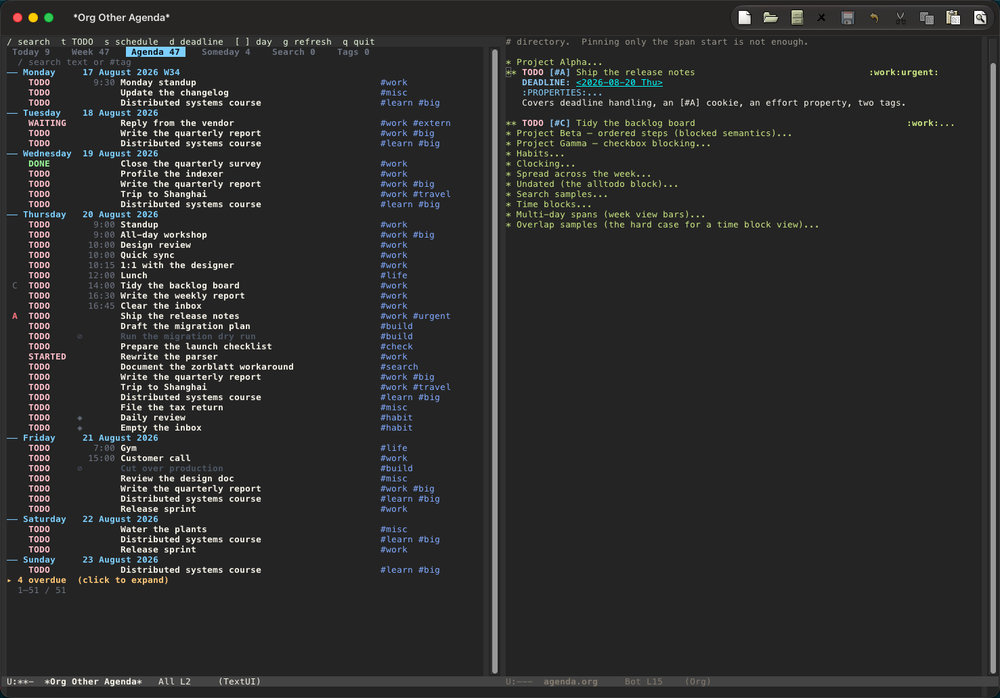

# org-other-agenda

Org's agenda is a list. This renders the same data as a board.

- a month calendar you can click, with density dots for scheduled days and deadlines
- a day view with time blocks whose height follows their duration, and lanes for overlaps
- a week view where multi-day tasks are drawn as bars spanning the days they cover
- a Someday list of everything with no date, so you can schedule it from there
- search that reaches entry bodies, not just headings

Nothing about Org changes. A hidden agenda buffer is produced by Org itself,
its per-line text properties are read back, and the result is re-laid out with
[TextUI](https://github.com/yibie/textui). Sorting, filtering and every
`org-agenda-*` command keep their own semantics; entry identity stays
`org-hd-marker`.

## Screenshots



Today combines the month calendar with proportional time blocks, four-way
overlap lanes, and numbered overflow entries.



Week draws multi-day tasks as bars spanning the dates they cover.



List shows agenda rows with separate TODO state and condition columns.

## Status

Early, but usable. Rendering, the calendar, time blocks, week bars, search and
command forwarding all work against real Org data.

## Requirements

Emacs 29.1 or newer, Org 9.6 or newer, TextUI, and Embark.  Embark is
required because actions on board objects are discovered and invoked through
`embark-act`.

## Install

```elisp
(add-to-list 'load-path "/path/to/textui")
(add-to-list 'load-path "/path/to/org-other-agenda")
(require 'org-other-agenda)
```

Then `M-x org-other-agenda`.

Your `org-agenda-files` and every other Org setting are used as they are.
The package overrides nothing.

## Time-block hours

The default range is 08:00–18:00. To include evening events:

```elisp
(setq org-other-agenda-time-start-hour 7
      org-other-agenda-time-end-hour 23)
```

Hours are integers satisfying `0 <= start < end <= 24`; the end is exclusive.
Settings apply on the next render (press `g` in an open board). They change
only the displayed time range, not Org timestamps or `org-agenda-time-grid`.
Time-block row sizes remain unchanged: Today uses 30-minute rows.

## Tabs

| Tab | Shows |
|---|---|
| Today | a month calendar and the selected day's time blocks |
| Week | the week, with multi-day tasks as spanning bars |
| Agenda | the daily/weekly agenda as a list |
| Someday | entries with no date at all — schedule them from here |
| Search | results of the last text search |
| Tags | results of the last tag search |

Someday and Agenda are complementary and do not overlap: everything with a date
is in Agenda, everything without one is in Someday.

## Interaction model

The design grew out of [an r/emacs discussion](https://www.reddit.com/r/emacs/comments/1vuw4lp/comment/p559avf/)
about what happens when an Emacs interface gains a second dimension. Classic
list interfaces work because "current line = current object." Today and Week
break that equation: point can be inside a heading, a time slot and a day at
the same time. A 2D interface needs a way to act on "the object whose rectangle
contains point."

org-other-agenda separates movement from action. Movement is a small set of
view-wide verbs: next, previous, four directions, parent and panel changes.
Actions belong to typed nouns at point: `org-heading`, `ooa-slot` and
`ooa-day`. Embark is the discoverable menu for those nouns; direct keys are the
fast path once the action becomes familiar.

Point remains the only persistent target. On an occupied Today cell, Embark
can cycle through `org-heading` → `ooa-slot` → `ooa-day`, and the next action
uses the noun that was actually selected. The same model covers empty time
slots, Week bars, date headers and ordinary list rows without pretending they
are all widgets or all lines.

## Keys

| Group | Key | Action |
|---|---|---|
| Move | `n` `p` | next / previous entry row |
| Move | arrows | move among structural neighbors in the current panel |
| Move | `M-n` `M-p` | first object in the next / previous panel |
| Move | `u` | move to the current object's container, then panel title |
| Move | `TAB` / `S-TAB` | move between focusable widgets |
| View | `[` `]` | previous / next selected day |
| View | `j` | go to a date (`org-read-date`) |
| View | `.` | go to today and restore the configured date range |
| View | `v` | choose how many days to show (a number, or day / week / fortnight / month / year) |
| Move | `C-v` `M-v` | scroll a long list |
| Change the entry occurrence at point | `S-<left>` `S-<right>` | move its native Org timestamp earlier / later |
| Change the heading at point | `S-<up>` `S-<down>` | raise / lower its native Org priority |
| Act on the entry at point | `t` `s` `d` `,` `:` | TODO state, schedule, deadline, priority, tags |
| Act on a Today overflow/pinned entry | `C-c C-p` | pin / unpin it in the main time-block lane |
| Act on the entry at point | `RET` or mouse-1 | visit the Org entry |
| Act on the entry at point | `embark-act` | open the Embark menu; the full `embark-org-heading-map` is available |
| Select | `m` | mark one heading, a whole day, or complete a structural rectangle |
| Select | `U` | clear all heading marks and the pending rectangle anchor |
| Act on the marked set | `B` | run native `org-agenda-bulk-action` |
| Act on the marked set at a day / empty slot | `s` | schedule every marked heading on that date / at that time |
| View | `1`–`6` | switch tab |
| View | `/` | search |
| View | `\` | clear the search |
| View | `g` | refresh |
| View | `q` | quit |

The editing keys forward to native `org-agenda-*` commands, so your TODO
sequences, logging and hooks all apply. Bare arrows move point through the
renderer's stable `(panel column row)` coordinates; they do not edit Org.
`C-n`, `C-p`, `C-f` and `C-b` retain their normal Emacs meanings. The month
calendar, the tab bar, the overflow markers and the overdue fold are clickable.

### Heading sets and rectangles

There is one marked-heading set, shared by every page. A heading that appears
more than once is stored once and highlighted at every visible occurrence.
Press `m` on a heading to toggle it and leave a rectangle anchor. Move with the
arrows and press `m` at another cell in the same panel to add the closed
column/row rectangle; press `m` again without moving to end the gesture while
keeping the single mark. Pressing `m` on a day heading toggles every heading on
that date. `U` clears the set without changing Org.

`B` resolves the set back to the current hidden agenda and invokes Org's own
bulk prompt. It therefore has native bulk failure semantics: processing stops
at the first error, completed changes are not rolled back, and the package
marks remain so the set is still actionable. On success, marks follow
`org-agenda-persistent-marks`.

An empty Today time cell is an `ooa-slot`; calendar cells and Week/Agenda date
headers are `ooa-day` objects. Their `s` action schedules every marked heading
through native `org-agenda-schedule`. Slot scheduling uses the slot's start
time, while day scheduling writes a date without a time. Unlike `B`, this path
continues after an individual failure, removes successful headings from the
set, retains failures, and reports both counts at the end. Use `embark-act` to
discover the nested heading → slot → day actions on occupied cells.

On Today, an overflow heading conditionally adds a pin action to its Embark
menu; once pinned, the same action becomes unpin.  `C-c C-p` is its direct
shortcut.  The numbered overflow button retains its existing RET/mouse action.

## Searching

`/` takes a query. A query starting with `#` matches tags, anything else is a
full-text search:

```
review            full text, including entry bodies
#build            tagged build
#work+urgent      Org's own tag matching syntax
```

Both run Org's own `search` and `tags` agenda blocks, so Org's boolean syntax,
regexp support and tag inheritance all work. `\` clears the query and returns
to the cached agenda without regenerating it.

## Which blocks the agenda is built from

`org-other-agenda-series` has the shape of a command list in
`org-agenda-custom-commands`:

```elisp
(setq org-other-agenda-series
      '((agenda "" ((org-agenda-span 'week)))
        (alltodo "")))
```

Any block type Org accepts works here.

## Date range

The board shows the days its agenda blocks cover. The series' last agenda block
carries the date range: in a series like "today, then the next thirty days" it
is the thirty-day block.

- `v` asks how many days that block covers: a number, or a span name as in
  `org-agenda-span`. A numeric prefix argument answers directly, and so does a
  numeric prefix to `M-x org-other-agenda` (`C-u 45 M-x org-other-agenda`). The
  choice is kept in `org-other-agenda-span` for the rest of the session.
- `[`, `]`, `j` and clicks on the month calendar can select a day no block
  covers. The range block then moves by whole spans until it covers that day,
  the way `org-agenda-later` pages through an agenda, and Org rebuilds it.
- `.` returns to today and to the block's configured start.

When the range block moves onto a day that another agenda block already shows,
typically today, the other block's rows are the ones kept.

## Performance

Measured on a synthetic 2000-entry file:

| | before | after |
|---|---:|---:|
| a search | 3802 ms | 8 ms |
| clearing a search | full regeneration | 0 ms |
| first render | 1025 ms | 323 ms |
| re-rendering the Agenda tab | 1155 ms | 17 ms |
| re-rendering the Today tab | 532 ms | 17 ms |

Long lists render only the rows that fit the window, so render cost tracks
window height rather than entry count. Switching tabs never regenerates the
agenda; only `g` and a new search do.

What remains is Org's own cost: building the hidden agenda buffer takes about
3.7 s for 2000 entries, the same as a native agenda over the same files.
Org's [own tuning options](https://orgmode.org/manual/Speeding-Up-Your-Agendas.html)
buy about 12% together, and the largest of them,
`org-agenda-dim-blocked-tasks`, is worth only 8% while disabling blocked-task
detection entirely — which this package uses for the blocked marker and for
deciding what belongs in Someday. Those settings are left to you rather than
forced in code.

## Column alignment needs a CJK font at exactly 2:1

If your Org files contain CJK text, columns can only align when a wide glyph is
drawn exactly twice as wide as a space. Emacs counts it as two columns
regardless, so a font that draws it narrower shifts every column after it. On
macOS, measure the current frame and solve for the CJK size instead of using a
fixed value:

```elisp
(let ((space (string-pixel-width " "))
      (family "PingFang SC")
      best)
  (dolist (size (number-sequence 8 30))
    (set-fontset-font t 'han (font-spec :family family :size size))
    (set-fontset-font t 'cjk-misc (font-spec :family family :size size))
    (when (= (string-pixel-width "中") (* 2 space))
      (setq best size)))
  (when best
    (set-fontset-font t 'han (font-spec :family family :size best))
    (set-fontset-font t 'cjk-misc (font-spec :family family :size best))))
```

Run this after the GUI frame exists, and run it again if the default font
height changes: a hard-coded size stops being 2:1 after a theme, DPI, or text
scale change. In a terminal the problem does not arise; the terminal enforces
the cell grid itself.

## Overlapping time blocks

When several tasks overlap, lanes are allocated from the available width, at
most three and never narrower than 20 columns. Whatever does not fit is listed
below the grid with a number; clicking that number pins the entry into the main
lane and pushes the current occupant out. Lane geometry is fixed for the whole
day, so bars never shift horizontally between rows.

## Try it without installing

For your own Org files, load the package and run `M-x org-other-agenda`. It uses
your existing `org-agenda-files` and Org settings without overriding them.

For a repeatable checkout demo, evaluate this small snippet in a throwaway
`emacs -Q` session after loading the package:

```elisp
(require 'calendar)
(require 'org-other-agenda)
(setq org-agenda-files
      (list (expand-file-name
             "test/fixtures/agenda.org" "/path/to/org-other-agenda"))
      org-enforce-todo-dependencies t
      org-enforce-todo-checkbox-dependencies t
      org-agenda-dim-blocked-tasks t
      org-habit-show-habits t)
(advice-add 'org-today :override
            (lambda () (calendar-absolute-from-gregorian '(8 20 2026))))
(org-other-agenda)
```

Loads the package against a synthetic fixture with a pinned date, so the view is
reproducible. The fixture is in `test/fixtures/` and covers blocked tasks,
habits, a running clock, multi-day spans and a four-way overlap.

## Development

```
make check                 compile, checkdoc and the test suite
make ORG=/path/to/org/lisp check    against a newer Org checkout
```

## License

GPL-3.0-or-later.
